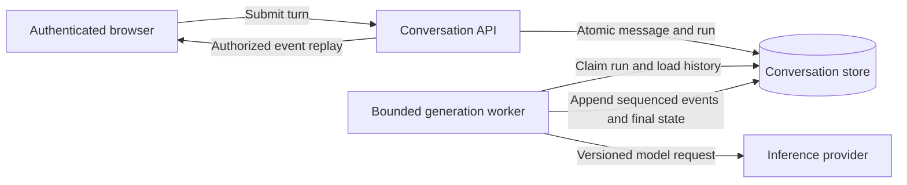

# Design a bounded AI chatbot

## Candidate prompt

**AI-SD-02 — Intermediate; full-stack/AI; architecture; 0–2 years; company-neutral.** Design an authenticated assistant with stored conversations and streamed responses. Start with text-only answers, no external tools and no private-document retrieval. Explain isolation, concurrent turns, reconnect and provider failure.

Clarify retention, eligible users, response-quality expectations, latency and what “cancel” promises. Attempt before expanding the reference.

Reference design and failure analysis

### Contract and ownership

The product API owns conversations, authorized membership, messages and generation runs. A submit operation accepts a stable client request key and the expected conversation version. It durably creates one run or returns a conflict when another writer invalidated that version. Decide whether simultaneous user turns are queued, rejected or branched; do not silently interleave two assistant answers into one message.

A worker owns execution of the accepted run. It loads only authorized history, applies a token budget, chooses a recorded model/prompt version and calls the provider under a deadline. The provider is an external dependency, not the owner of application permissions or authoritative conversation state.

### Streaming and reconnect

Give events monotonically ordered IDs within a run. Persist the events the application promises to replay before exposing them. A reconnect supplies run ID and the last event actually applied to the client state; the server reauthorizes access and sends later retained events, or explicitly signals that replay history expired. The client deduplicates by run/event ID. A transport receipt cursor can differ from applied application state; recover a coherent snapshot plus watermark and durable catch-up when necessary, rather than silently skipping unapplied events. Exact event formatting is an application contract, not supplied by a TCP connection.

A partial stream is not a completed answer. Store final status separately from accumulated text; prevent an unhandled exception from leaving the UI looking successfully complete. Backpressure bounds slow-consumer buffers. A durable run does not make an in-memory worker durable: recovery must claim unfinished work and define whether generation restarts or terminates after a crash.

### Cancel and failure

Cancel requests mark intent and attempt to stop provider work. Disconnecting the browser need not mean cancel; choose the product policy. Already generated/billed tokens may not be recoverable, and provider cancellation support varies. A retry can generate different text; avoid appending it to the previous partial output as though it were the same attempt. Store attempt identity and declare replacement/restart behavior.

### Quality, privacy and tradeoff

Use a small labeled set of real task types, harmless failures and refusals; measure usefulness and incorrect assertions separately from availability. Redact telemetry and define conversation deletion across active storage, caches and retained logs/backups. A simpler synchronous request can be adequate without replay requirements; the durable event model costs storage and operational work.

## Followups and checklist

What if permission is revoked mid-stream? Define the permitted exposure window and revalidation points; a past stream cannot be retracted. What if the same submit is retried? Stable idempotency prevents two accepted runs under the chosen scope, while worker attempts still need recovery rules.

- [ ] Conversation concurrency, final status and partial output are distinct.
- [ ] Replay is backed by retained data and current authorization.
- [ ] Provider outage and worker crash behavior are explicit.

## References

- [AWS Builders Library: timeouts and retries](https://aws.amazon.com/builders-library/timeouts-retries-and-backoff-with-jitter/).
- [Google SRE: alerting on SLOs](https://sre.google/workbook/alerting-on-slos/).
- [OWASP: authorization](https://cheatsheetseries.owasp.org/cheatsheets/Authorization_Cheat_Sheet.html).
- [Phase 3 source metadata](PHASE3_SOURCES.md).

## Last verified

2026-11-02: source scope, illustrative flows and reasoning reviewed. Architecture and workload assumptions are original [INFERRED] teaching material, not a company disclosure or measured deployment.
