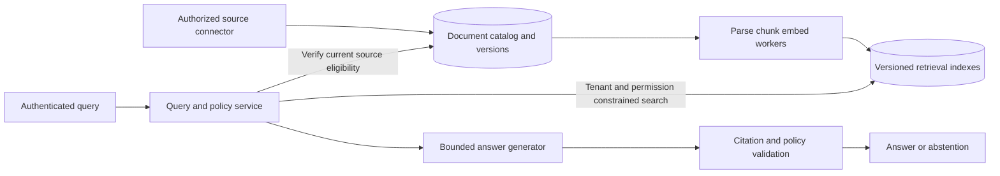

# Design an enterprise RAG platform

## Candidate prompt

**AI-SD-04 — Intermediate/Advanced; RAG/AI/backend; design; company-neutral.** Design answers with citations over private organizational documents. Multiple tenants, changing permissions and deletion matter. Distinguish an authorized relevant source from a plausible generated answer.

Clarify corpus types, ingestion/update rate, access-control model, freshness, deletion expectations, query volume and evidence standard. Attempt first.

Reference architecture and failure reasoning

### Ownership and ingestion

A document catalog owns tenant, source ID, immutable version, current eligibility and permissions. Ingestion workers parse/OCR where needed, record provenance/offsets, chunk, embed and index an explicit document version. Object storage retains permitted original content; the index is a derived view, not the authority for access. Track parse errors, unsupported files and ingestion lag instead of silently indexing empty text.

### Query and evidence flow

Authenticate, resolve tenant/principal policy and retrieve only eligible candidates within the defined access model. Apply current authorization to candidates before text enters model context, including caches and reranker inputs. Search filtering strategy must be supported by the chosen engine; approximate search with a selective filter can reduce recall, so measure the actual pipeline under its permissions.

Combine lexical/dense candidates if evaluation justifies it, rerank within a candidate budget, then select chunks under a token limit. Keep source/version/offset metadata attached through generation. A citation validator checks that the cited source exists, is still authorized and supports the associated claim. Mere URL presence does not establish support or external truth. Abstain or qualify when evidence is absent, stale or contradictory.

### Update and deletion

Build a new document/index version, validate it and switch visibility atomically at the catalog boundary where practical. Reject old generations after a permission or tombstone change. Async deletion may remove vectors later, but a current tombstone check must prevent stale indexed content from being surfaced within the promised exposure bound. Also handle text caches, embeddings, conversation copies, exports and backup retention under an explicit policy.

### Evaluation and scaling

Separate ingestion fidelity, retrieval Recall@k/ranking, permission violations, answer support, citation accuracy and latency/cost. Maintain labeled answerable and unanswerable questions, difficult identifiers, OCR failures and revoked sources. Do not rank vector stores by unsubstantiated global speed claims. Measure corpus size, filter selectivity, index update cost, tenant skew and recovery behavior on the actual workload.

### Failure and tradeoff

A connector outage produces freshness lag, not proof that a document was deleted. A stale index must not bypass the current authorization service. If policy authority is unavailable, do not serve private cached text without a defined safe contract. A simple PostgreSQL-backed corpus may be adequate initially; a dedicated retrieval service adds operational choices when measured access/scale needs justify them.

## Followups and checklist

How do you evaluate retrieval when permissions differ by user? Construct principal-specific relevance judgments. How do you handle a correct answer citing a different source? Evaluate citation alignment independently from general answer plausibility.

- [ ] Catalog authority, derived indexes and source versions are distinct.
- [ ] Revocation/deletion propagation covers every copy with stated bounds.
- [ ] Retrieval and generation have separate metrics and failure labels.

## References

- [Lewis et al.: original RAG paper](https://arxiv.org/abs/2005.11401).
- [OWASP: authorization](https://cheatsheetseries.owasp.org/cheatsheets/Authorization_Cheat_Sheet.html).
- [Phase 3 source metadata](PHASE3_SOURCES.md).

## Last verified

2026-11-02: source scope, illustrative flows and reasoning reviewed. Architecture and workload assumptions are original [INFERRED] teaching material, not a company disclosure or measured deployment.
