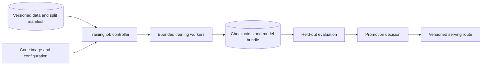

# Design a reproducible model-training platform

## Candidate prompt

**AI-SD-11 — Advanced extension; ML/platform; design; company-neutral.** Train and promote models from versioned data with experiment tracking, checkpoint recovery and controlled deployment. Begin with one small CPU/GPU workload; do not assume every candidate needs cluster-scale expertise.

Reference platform

A dataset registry records immutable source snapshots, label definitions, split assignments and feature availability. A job service owns queued/running/failed/completed state, resource requests, image/configuration versions and attempt identity. An artifact store retains checkpoints and final bundles. An experiment index records metrics and provenance; a promotion service applies human/product policy before changing a serving route.

### Normal flow and reproducibility

Validate the dataset and split before training. Record seed, preprocessing, code, dependency/runtime, hardware/distributed settings and configuration. Fit transforms using only the proper training partition. Save model, optimizer/scheduler, training progress and relevant random state for a resumable run. A seed alone does not prove bitwise reproducibility across hardware or nondeterministic operations.

A checkpoint must be complete and recoverable: write to a temporary artifact, validate metadata/checksum as appropriate, then publish an immutable manifest. A partial file is not a completed checkpoint. Retrying a job creates a distinct attempt while preserving lineage; do not overwrite a successful artifact with an incomplete retry.

### Distributed extension

Data-parallel workers partition samples and synchronize gradients; replicated optimizer/model state can become a memory limit. Model/tensor/pipeline sharding changes communication and failure handling. Global batch size, accumulation and loss reduction affect optimization. Increasing worker count is not a guaranteed linear speedup or mathematically identical training run.

### Evaluation and promotion

Compare to baselines on untouched evaluation data, inspect slices, verify data rights and record uncertainty. Never choose hyperparameters on the final test set and then present that score as unbiased. Promotion bundles weights and transformations; a model with the wrong feature order can pass file loading but fail predictions.

### Security and operation

Treat datasets, checkpoints and training images as controlled artifacts. Avoid executing arbitrary uploaded model code in privileged workers. Quotas, maximum runtime, cancellation, stale-job detection and cost attribution protect shared resources. Logs must not leak raw sensitive samples. Restore testing and artifact retention are part of the operating plan.

## Practice and checklist

A job resumes from weights only and obtains a different learning curve. Explain missing optimizer/progress/random state and nondeterminism before blaming the framework.

- [ ] Data, code, transforms and splits are reproducible manifests.
- [ ] Checkpoint completeness and retry ownership are explicit.
- [ ] Evaluation and promotion are separate from training success.

## References

- [Martin Zinkevich: Rules of ML](https://developers.google.com/machine-learning/guides/rules-of-ml).
- [Google SRE: alerting on SLOs](https://sre.google/workbook/alerting-on-slos/).
- [Phase 3 source metadata](PHASE3_SOURCES.md).

## Last verified

2026-11-02: source scope, illustrative flows and reasoning reviewed. Architecture and workload assumptions are original [INFERRED] teaching material, not a company disclosure or measured deployment.
