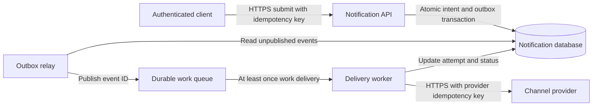
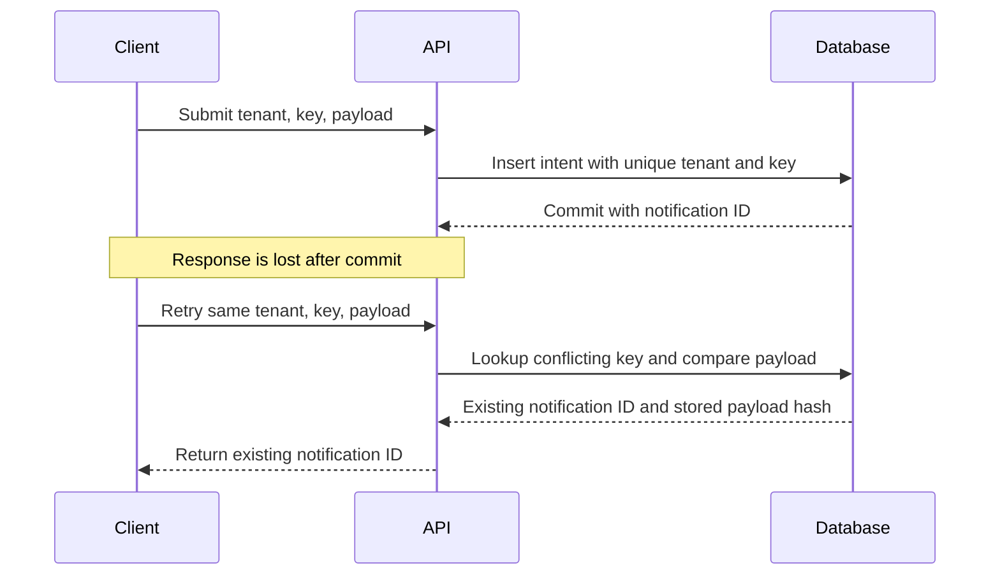

# Architecture diagrams

## A diagram has a question to answer

A context diagram shows actors and system boundaries. A component/container diagram shows runtime responsibilities and storage ownership. A sequence diagram explains ordering and failures. A data model identifies entities and invariants. Do not force all of these into one unreadable graph.

A diagram's arrow should name a contract: synchronous HTTP request, database transaction, asynchronous event or cache lookup. “Connects to” hides whether one service waits for another, retries it or owns its data.

## Component example: accepted notification intent

The database owns accepted intent, outbox and local attempt history. The queue is transport, not the authoritative record of user-visible state. The relay may publish a duplicate after a crash. Worker and API are separate runtimes but can belong to one modular application's ownership boundary.

Do not infer an exactly-once external effect from this picture. See [the notification case](Classic-System-Design/Notification_System.md).

## Sequence example: retry after a lost response

If the key is reused with a different normalized payload, reject it according to the API contract. The uniqueness constraint also covers two simultaneous first attempts. A preflight lookup alone does not.

## Label assumptions next to the graph

State whether a database symbol means one logical primary with replicas or a single unreplicated process. State the failure domain and trust boundary. If authentication is performed at a gateway, show how identity reaches the application and where object-level authorization occurs. A diagram's “cache” label does not imply a freshness guarantee.

For interview readability, use one critical flow, roughly five to eight meaningful components, and a separate deep-dive drawing when necessary. This is an editorial readability heuristic, not a correctness rule.

## Practice question

**SD-DIAG-01 — Beginner; SDE/AI/backend; design; 0–2 years.** An architecture has API → database and API → queue arrows. What atomicity question must you ask?

Expected answer and common mistake

Ask what happens if the database commits but queue publication fails, and the reverse. A transactional outbox can persist intent and event in one database transaction, followed by eventual publication and consumer deduplication. Merely drawing the arrows in order is not an atomicity mechanism. Followup: what happens if the relay publishes then crashes before marking the outbox entry sent?

## Checklist

- [ ] Actors, boundaries, protocols and owners are named.
- [ ] Synchronous waiting differs visibly from asynchronous work.
- [ ] Diagram and prose have the same critical flow.
- [ ] Retries, duplicates and a lost response are explainable.
- [ ] Diagrams remain hypothetical unless supported by deployment evidence.

## References

- [AWS Builders Library — timeouts, retries and backoff with jitter](https://aws.amazon.com/builders-library/timeouts-retries-and-backoff-with-jitter/)
- [Amazon SQS — standard queue at-least-once delivery](https://docs.aws.amazon.com/AWSSimpleQueueService/latest/SQSDeveloperGuide/standard-queues-at-least-once-delivery.html)

## Last verified

2026-11-02: teaching explanation and source scope reviewed. All numerical workloads and product designs are illustrative, not measured production facts.
