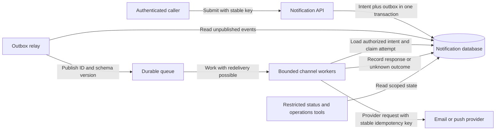

# Design a notification system

## Candidate prompt

**SD-CASE-NOTIFY-01 — Intermediate/Advanced; backend/AI/platform; system design; 0–2+ years.** Design a multi-tenant API that durably accepts transactional notifications and dispatches email and push through external providers. Users need status lookup; operators need to diagnose delayed or failed delivery. Explain retries, duplicate risk, consent and provider outages.

This is an original hypothetical system, not a description of a real company's internals. Suggested practice time: 45–60 minutes. Attempt before opening the discussion. Advanced followups are extensions rather than prerequisites for every early-career interview.

## Clarifying questions

What exactly does “delivered” mean? Which channels, consent rules, delay/expiry bounds and duplicate tolerance apply? Are users in multiple regions? What is peak fanout? Can providers accept an idempotency key and report status? May pending work be cancelled, and how long must intent/attempt records be retained?

Reference discussion: requirements, architecture and failure analysis

## Requirements and assumptions

Must: accept one channel/recipient notification per request, authenticate the caller, enforce tenant access, persist accepted intent, dispatch asynchronously, expose status and record failures. Recipients are represented by authorized references rather than arbitrary addresses from untrusted callers. Check user consent/suppression before sending according to channel/product policy.

Should: support bounded retries, per-tenant fairness and cancellation before dispatch. Exclude campaign authoring, cross-channel sequencing and guaranteed device receipt. For this exercise assume one region, 1 million notifications/day, a 20× peak factor, and a provisional objective that 99% of eligible accepted non-expired jobs reach provider acceptance within 60 seconds when the provider is healthy. Provider outages need a separate expiry/degraded policy. None of these values is a measured target.

Average arrival rate is 1,000,000/86,400 = 11.574/s; illustrative peak is 231.481/s. If a representative test shows one worker can sustainably complete 50 jobs/s for this workload, five workers nominally supply 250/s, but losing one leaves 200/s—below peak. Six would leave 250/s after one loss. That is a capacity scenario, not a provider benchmark. Provider quotas, channel mix and retries can dominate and require separate budgets.

## API and durable state

`POST /v1/notifications` accepts a tenant-scoped idempotency key, recipient reference, channel, versioned template and validated variables. Return `202 Accepted` only after durable local acceptance. Include the notification ID and status URL. This does not claim the user has seen a message. Reusing the same key/payload returns the same accepted ID; a different payload under the key is rejected.

`GET /v1/notifications/{id}` authorizes tenant/object access and distinguishes accepted, queued, dispatching, provider-accepted, retry-pending, permanently-failed, expired and cancelled states. Define which transitions are authoritative; do not call provider acceptance “read by user.” A cancellation endpoint can promise cancellation only before the worker wins the dispatch transition; the exact race must be defined.

The notification module owns accepted intent, idempotency records, a durable outbox and status history. The delivery module owns attempts, leases and provider response metadata. The provider owns its acceptance/delivery evidence. Keep a provider message ID for reconciliation. Recipient PII and secrets need restrictive storage/log access and explicit retention.

## Architecture and normal flow

The API validates identity, tenant membership, recipient/template permissions and quotas. In one local transaction it inserts the accepted intent and its outbox event, with unique constraints covering the idempotency key. A relay publishes the event and marks it published. A crash after publication but before marking can produce a duplicate, so the queue payload includes a stable event/notification ID.

Workers resolve the authoritative record rather than trusting arbitrary queue payload fields, check expiry/consent and claim eligible work using a transactional state/lease mechanism. A lease improves coordination but can expire while a paused worker still runs; it is not proof of exactly-once sending. Use a provider idempotency key stable across retries of the same intended send when supported. Record attempt identity and response before acknowledging completion as the broker contract requires.

## Durable intent does not equal exactly-once email

Consider a provider accepting a send just before the network times out. The worker cannot infer whether the effect occurred. A local unique event table cannot atomically wrap the provider's system. If the provider accepts idempotency keys, retry the same logical operation within its documented retention/scope. If not, the product must choose and disclose a duplicate-versus-loss tradeoff, or use provider reconciliation when available. A queue's at-least-once transport guarantee is not an exactly-once business outcome.

Distinguish submission attempts from separate intended notifications: two genuinely different password-reset requests may intentionally create two messages. Deduplicate only within the chosen business contract.

## Retry, outage and overload policy

Classify invalid recipient/template or revoked permission as permanent or suppressed according to policy. Retry transient provider/network failures only within bounded attempts/age, with backoff and jitter. Honor provider throttling guidance where supported and prevent nested client/worker retry multiplication. Expire stale transactional messages instead of delivering them days later without product approval.

Use per-provider and per-tenant concurrency/rate limits. Separate email and push queues/pools when one failing channel would otherwise block another. Queue depth, oldest age, accepted-to-provider latency and outbox age all matter. An empty queue can hide a broken relay. A dead-letter record needs an owner, reason, safe replay tool and updated permission/expiry checks before replay.

For 120,000 queued jobs, arrivals of 100/s and sustainable service of 300/s, net drain is 200/s and drain time is 600 seconds. Worker autoscaling must respect provider quotas. When sustained demand exceeds service, choose admission control, explicit deferral or expiry; unlimited queue growth is not a reliability plan.

## Cancellation, ordering and callbacks

Define a transactional boundary for cancellation: accepted/pending may transition to cancelled; dispatching may return “too late/unknown.” Never promise retraction after provider acceptance. If strict ordering matters, define its scope (for example per recipient/channel) and how a poison job affects later jobs. Global ordering can sharply limit throughput and is often unnecessary.

Provider callbacks need authenticity checks, replay protection and idempotent handling. They can arrive late or out of order. Preserve events and apply allowed monotone transitions rather than letting an old “pending” callback overwrite confirmed delivery. A final provider status still may not establish that a human read the content.

## Security, recovery and operation

Require tenant/object authorization for create/status/cancel and privileged replay. Treat template variables and returned provider data as untrusted. Store provider secrets with least privilege, redact payloads from broad logs, and audit administrative access. Suppression/consent changes must be enforced at the final appropriate boundary, including replay; cached recipient authorization can become stale.

| Failure | Detection | Recovery or explicit limitation |
|---|---|---|
| Commit succeeds; API response lost | Key/status lookup | Retry stable key; no second intent |
| Relay outage | Oldest unpublished outbox age | Restore relay, bounded drain, expect duplicates |
| Worker crashes after provider accepts | Unknown attempt plus redelivery | Provider idempotency/reconciliation or declared duplicate risk |
| Provider down | Failure rate, timeout and age | Bound retries, isolate channel, expire by policy |
| Bad worker deployment | Version-correlated errors | Stop rollout, compatible rollback, preserve durable jobs |
| State loss/corruption | Integrity and restore checks | Tested backups/log restore within explicit RPO/RTO |

A dashboard should expose durable acceptance, provider acceptance, expiry, permanent failure and unknown outcomes separately. For the 99%-within-60-seconds objective, define the eligible population and how provider-outage exclusions are reported; do not hide user impact by excluding it silently.

## Main tradeoff

The outbox and durable state add storage, coordination and operational work, but prevent accepted intent from depending on a fragile request-to-queue handoff. Delivery remains bounded by external provider contracts. A simpler direct synchronous send can be defensible for a different best-effort requirement, but cannot claim durable asynchronous acceptance or recoverable dispatch without the corresponding mechanism.

## Followup questions

1. What changes for bulk fanout to a million recipients? Bound expansion, snapshot audience/permissions appropriately and avoid one giant transaction.
2. What if the provider's idempotency retention is shorter than our retry window? Reconciliation or a duplicate policy is needed beyond that boundary.
3. Can workers trust a message's tenant header? No; validate the message's provenance and load scoped authoritative data.
4. How do you migrate templates without changing already accepted intent? Persist the template version or rendered/immutable representation under an explicit privacy policy.

## Common mistakes and readiness

Avoid equating 202 with delivery, claiming exactly-once email, ignoring consent during replay, using queue depth as the only health signal or retrying forever. You should be able to trace the crash-before-commit, crash-after-publish and crash-after-provider-acceptance cases with different outcomes.

## References

- [Amazon SQS — standard queue at-least-once delivery](https://docs.aws.amazon.com/AWSSimpleQueueService/latest/SQSDeveloperGuide/standard-queues-at-least-once-delivery.html)
- [AWS Builders Library — timeouts, retries and backoff with jitter](https://aws.amazon.com/builders-library/timeouts-retries-and-backoff-with-jitter/)
- [Google SRE workbook — implementing SLOs](https://sre.google/workbook/implementing-slos/)
- [OWASP — authorization guidance](https://cheatsheetseries.owasp.org/cheatsheets/Authorization_Cheat_Sheet.html)

## Last verified

2026-11-02: teaching explanation and source scope reviewed. All numerical workloads and product designs are illustrative, not measured production facts.
