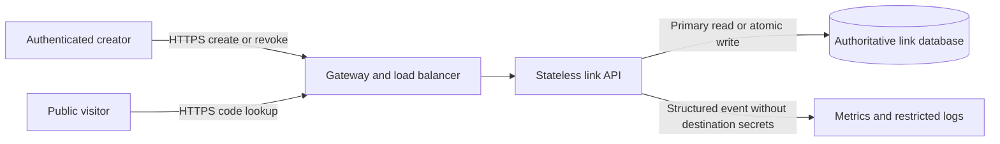

# Design a URL shortener

## Candidate prompt

**SD-CASE-URL-01 — Intermediate; SDE/backend; system design; 0–2 years.** Design a service that creates a short public code for an HTTP/HTTPS destination, redirects visitors, and lets creators revoke their own links. Start with one region and explain how you would scale without breaking uniqueness or revocation behavior.

This is an original hypothetical exercise, not an account of a particular company's architecture or interview question. Suggested practice budget: 45 minutes. Attempt the design before expanding the reference discussion.

## Clarifying questions

- Are links public bearer links or authenticated private resources?
- Can a destination be edited after creation, and are custom aliases required?
- What are creation/redirect volumes, popularity skew and retention?
- What revocation delay is acceptable across server and browser caches?
- Are analytics, previews, abuse checks or geographic routing required now?

Reference discussion: assumptions, architecture, flows and tradeoffs

## Requirements and scope

For this exercise, assume public redirects and authenticated creators. A creator can create/revoke only their tenant's links. Destinations are immutable after creation. Custom aliases, URL previews, full analytics and multi-region writes are out of scope. Support expiry and a minimal abuse-report/disable process.

Illustrative demand: 10 million creates and 100 million redirects/day, 10× peak factor, 365-day retention. Provisional redirect target: p95 below 150 ms at the service boundary under that load. Provisional availability: 99.9% of eligible redirect requests over 30 days. Revocation should stop newly processed redirects within five seconds; explain that a response already issued cannot be retracted. These values are teaching assumptions to negotiate, not observed facts or universal expectations.

## Capacity that affects the design

[Capacity estimation](../Capacity_Estimation.md) derives about 116 creates/s and 1,157 redirects/s on average, with an illustrative 11,574 peak redirects/s. At 500 stored bytes/link, raw annual storage is 1.825 TB before indexes/logs/backups. Retention, index size and skew affect feasibility as much as the average rate. No datastore capacity is proven by this calculation; representative tests must establish whether the proposed initial database/read path meets the target.

## API and data ownership

| Operation | Result | Important contract |
|---|---|---|
| `POST /v1/links` | `201 Created`, code, destination, expiry | Tenant-scoped idempotency key; same key/different payload is a conflict |
| `GET /{code}` | `302 Found` with validated `Location` | Active public code redirects; no user-supplied script scheme |
| `DELETE /v1/links/{code}` | Idempotent revoke result | Object authorization; repeats do not create a new side effect |

An HTTP redirect status does not itself decide browser-cache freshness; set explicit policy. Initially return `Cache-Control: no-store` for redirects to avoid intentional HTTP caching. This cannot force deletion of arbitrary client copies or undo a prior navigation.

The link module owns `code`, `destination`, `tenant_id`, `created_at`, `expires_at`, `revoked_at` and `version`. Code has a database-enforced uniqueness constraint. A separate tenant-scoped idempotency record stores normalized payload hash and resulting code, committed atomically with creation. A creator/time index supports a bounded paginated management list if later added. Avoid treating a cache as the authoritative uniqueness source.

## Baseline architecture

The baseline deliberately reads active/revoked state from the authoritative primary on every redirect. It avoids stale replica/cache reads while the freshness contract is being established. The load balancer routes requests; API replicas do not allocate unique codes independently without database coordination. Managed failover and backups need a defined durability/restore contract rather than an unexplained “replicas” label.

## Code allocation and create flow

Generate a random fixed-length code from a cryptographically suitable source, or use an allocated numeric ID encoded in base62. The random design makes casual enumeration harder but does not authorize access. Choose eight base62 characters for this illustration: 62⁸ = 218,340,105,584,896 possible codes. Capacity is not collision freedom. A unique insert is the final arbiter; on a generated-code collision retry a bounded number of times and return a retriable service error if that budget is exhausted.

Do not run a preflight “does code exist?” check and assume it prevents a concurrent conflict. For simultaneous requests with the same tenant/idempotency key, one transaction wins uniqueness enforcement; the other reads the committed operation and compares payload. Creation and idempotency outcome must be one transaction so a lost response can be replayed safely. Bound URL length, parse it correctly and allow only supported schemes.

A sequential allocator avoids random collisions but reveals approximate creation sequence and creates an allocation dependency. A block allocator reduces coordination but introduces gaps/recovery questions. Select one and explain the tradeoff; do not implement all three.

## Redirect, expiry and revocation flow

Resolve the code on the authoritative store; check expiry and revocation before returning the redirect. An unknown code returns the agreed not-found behavior; a revoked/expired code can return not-found or gone depending on enumeration/privacy policy. There is no requirement to reveal whether a private creator once owned it.

Revoke performs tenant/object authorization and an atomic state update. A newly started primary lookup after committed revocation sees the new state under its read contract; already-running requests may have read an earlier state. Bound lookup deadlines, avoid a long-lived transaction snapshot for this path, and define exactly which requests the five-second objective covers. On source failure, return an unavailable response rather than using an unbounded stale “active” result.

## Scaling and cache evolution

Measure primary CPU/I/O, query latency, active connections and hot codes. Index the lookup, bound API/database concurrency and test with realistic popular-key skew. Read replicas help only if their lag is compatible with revocation. A replica that can be arbitrarily stale cannot meet the five-second requirement by assertion.

A later application cache needs a freshness proof covering TTL, late-fill races, source-read deadlines, invalidation failure and browser behavior. Best-effort invalidation alone is insufficient. If that proof is not yet available, keep the authoritative-read path or explicitly renegotiate the freshness bound. Do not claim a particular cache hit ratio without workload evidence. Partitioning by code is a possible later storage evolution, but complicates creator lists, migration and recovery.

## Failure, security and operations

| Failure/risk | Behavior or control |
|---|---|
| Database commit succeeds, response lost | Retry same idempotency key; return existing code |
| Two generated codes collide | Unique constraint; bounded generation retry |
| Database unavailable | Fail redirect/create according to availability contract; do not invent a destination |
| API deployment fails | Stop rollout; roll back compatible binary; preserve data |
| Malicious destination | Scheme/length validation, creation limits, reporting and rapid disable |
| Preview fetch introduced later | Separate restricted fetcher and SSRF threat review before enabling it |
| Accidental deletion/corruption | Tested restore with explicit RPO/RTO; replica alone is not a backup |

Measure redirect success/latency, create conflicts, lookup errors, expiry/revocation correctness and resource saturation. Keep raw destinations and visitor identifiers out of broad logs where unnecessary. Rate-limit abusive creation and guessing; rate limits are protection, not replacement for permission checks on management endpoints.

## Main tradeoff

The baseline favors clear revocation semantics and operational simplicity over aggressive caching. That may limit throughput at the illustrative workload; load testing is required before claiming it meets the target. The next optimization should address the measured bottleneck while preserving the chosen freshness contract.

## Followup questions

1. How does the design change for private links? Require authorization on redirect; a hard-to-guess code alone is not access control.
2. Can `301 Moved Permanently` be used? Discuss HTTP semantics, browser caching and revocation requirements before choosing it.
3. What if one code receives half the traffic? Examine hot-key/read capacity and cache freshness, not only overall averages.
4. How would destination edits change idempotency, versioning and caching?

## Common mistakes and readiness

Do not promise collision-free random generation, store an unvalidated script URL, infer capacity from an RPS estimate, or allow a cache/replica to violate revocation silently. You are ready for the next exercise when you can trace concurrent creation, a lost create response, and revocation without contradicting the diagram.

## References

- [RFC 9110 — HTTP semantics](https://www.rfc-editor.org/rfc/rfc9110.html)
- [RFC 9111 — HTTP caching](https://www.rfc-editor.org/rfc/rfc9111.html)
- [PostgreSQL — indexes](https://www.postgresql.org/docs/current/indexes.html)
- [PostgreSQL — transaction isolation](https://www.postgresql.org/docs/current/transaction-iso.html)

## Last verified

2026-11-02: teaching explanation and source scope reviewed. All numerical workloads and product designs are illustrative, not measured production facts.
