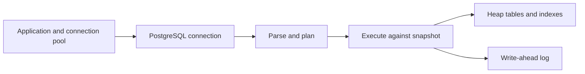

# PostgreSQL: a working mental model

## Overview

PostgreSQL is a relational database with SQL, constraints, transactions and multiple access methods. For an early-career interview, explain how a request reaches storage and where correctness is enforced before memorizing configuration names.

This chapter describes PostgreSQL concepts using version 18 documentation; the disposable validation runtime is version 16.15. No version-18-only feature is claimed to be locally tested.

## Request path

The pool bounds concurrent connections; it does not make an unsafe transaction safe. The planner chooses an execution strategy. The executor reads rows visible to its snapshot and applies writes and constraints. Heap storage, indexes and the write-ahead log have different responsibilities; an index is an access structure, not a replacement for a business invariant.

## MVCC and maintenance

Multi-version concurrency control lets transactions reason about visible row versions. Ordinary reads and writes often coexist without blocking each other, but writers, row locks, schema locks and long transactions can still contend. Snapshot visibility and lock acquisition are separate concerns. [Concurrency control](https://www.postgresql.org/docs/18/mvcc.html)

Updates/deletes leave versions that may later be reclaimable. Vacuuming maintains reusable space and visibility information; analyze updates planner statistics. Autovacuum performs maintenance automatically, but long-lived snapshots can delay cleanup. Ordinary `VACUUM` generally makes space reusable inside the relation rather than shrinking its file to the operating system. Avoid saying “MVCC never locks” or “vacuum is just deleting old rows.” [Routine vacuuming](https://www.postgresql.org/docs/18/routine-vacuuming.html)

## Data types and constraints: choose a representation deliberately

- Use an exact representation for exact values: integer minor units or suitable `numeric` for money, with explicit currency and rounding rules. Floating point is unsuitable when approximate equality is unacceptable.
- Use `timestamptz` for an instant. Rendering depends on the session time zone; it does not preserve the original named zone. Store a business zone separately when it matters for recurring local schedules.
- A primary key identifies rows. A foreign key enforces referenced identity. A `NOT NULL` plus `CHECK` can enforce a required domain range; a check alone does not reject null when its expression is unknown.
- A unique constraint prevents concurrent duplicate keys. “Check then insert” in application code without enforcement races under concurrent requests. [Constraints](https://www.postgresql.org/docs/18/ddl-constraints.html), [date/time types](https://www.postgresql.org/docs/18/datatype-datetime.html)

The shared fixture deliberately uses explicit ids and small integer-cent values. A real multi-currency ledger needs additional rules, so do not promote this schema to production payments design.

## Connections and transactions

Acquire a connection, begin the transaction, execute all dependent statements on that same transaction/connection, then commit or roll back and release it. Avoid remote HTTP calls while holding locks. A transaction-scoped pool may return another physical session for the next transaction; relying on persistent session state without checking pool behavior is unsafe.

Give queries a bounded time budget and handle cancellation. A cancelled client request does not prove the database write was never committed. If commit acknowledgement is lost, reconcile using a durable operation identifier; do not blindly issue a second charge.

## First diagnostic for a slow API

Break the latency into pool wait, database execution, row transfer/serialization and application work. Then inspect locks and active transactions, the relevant query plan, row-count estimates and workload. A fast query plan does not explain connection starvation; a faster index does not correct an overloaded pool.

Illustrative scenario: a ten-connection pool handles ten requests whose transactions wait on an external API for five seconds. New database calls queue even if their SQL needs milliseconds. The immediate hypothesis is connection occupancy; measure it before tuning SQL.

## Interview practice

[INFERRED] Beginner–Intermediate, backend/SDE, technical or project deep dive.

1. **PG-01:** Why can a database file grow after many updates even when row count is stable? Evaluates row-version lifecycle and maintenance.
2. **PG-02:** Why does a pooled application need explicit transaction handling? Evaluates connection ownership and correctness boundaries.

Expected answer and followups

1. Obsolete versions, free space and indexes affect physical size. Check maintenance, long transactions and workload before attributing growth to a leak. Followup: why is freeing reusable pages different from returning bytes to the OS?
2. Related statements must share a transaction; session assumptions may not survive pool reuse. Use commit/rollback on all paths and avoid holding connections during unrelated work. Followup: what do you do after an ambiguous commit acknowledgement?

Mistakes: promising no locks with MVCC; treating replicas as backups; reading untrusted tenant identity from a pooled connection's stale session variable. Related: [isolation](Isolation_Levels.md), [transactions](Transactions_and_ACID.md), [authorization](Authorization.md).

## Checklist and references

- [ ] Explain snapshot visibility, row locks, WAL, vacuum and analyze separately.
- [ ] Explain one correct data type choice and one violated invariant.
- [ ] Separate pool wait from SQL execution time.

Last verified **2026-11-02**: documentation review and fixture execution scope in [validation](../validation/database/README.md). Sources: linked official PostgreSQL chapters; [source register](PHASE2_SOURCES.md).
