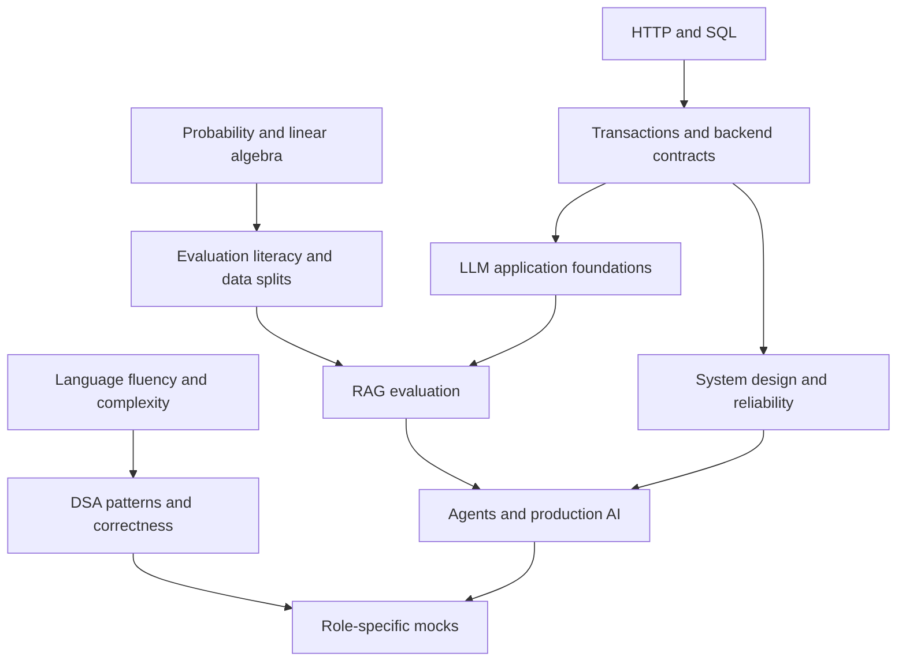

# Master interview roadmap

## Starting point

[INFERRED] Use **SDE/backend + applied AI** as the primary track and full-stack AI as the adjacent track. Maintain ML foundations; specialize in training/research only after a diagnostic shows the necessary math and experimentation skills. This recommendation follows your stated priorities and early-career profile, not a claim about the hiring probability of any company.

Assume **12 focused hours/week** for an initial 16-week cycle. This is a planning budget, not a readiness promise. If 6 hours are available, stretch the cycle roughly twofold and preserve the practice gates. Select at most two active role tracks. Advanced research, GPU kernels and large-scale distributed training are optional extensions for relevant postings.

## Baseline: first two sessions

Without AI hints or solution lookup, attempt a hash-map problem, a linked-list transformation and a tree traversal. Use Java for DSA unless a target interview requires another language. Record reasoning, complexity, tests and hints, not just accepted status. Existing Java files provide practice starting points; their correctness has not been audited here.

Then explain one real project for two minutes, sketch a small HTTP API with a database, write a join plus aggregation, explain train/validation/test separation, and diagnose a slow endpoint. Score each with the scale in [the tracker](PROGRESS_TRACKER.md). Choose the weakest prerequisite, not the most fashionable topic, for the first extra session.

## Learning sequence

| Weeks | Main work | Concrete output | Gate to advance |
|---|---|---|---|
| 1–2 | Complexity, arrays/strings, hashing, Java collections, basic HTTP and SQL | 6–8 carefully reviewed DSA attempts, one API/data sketch, baseline log | Explain an invariant and test empty, duplicate and boundary inputs without prompting |
| 3–4 | Two pointers, windows, binary search, lists, stacks/queues; SQL joins/indexes | Pattern notes, one query-plan explanation, project 30-second/2-minute pitches | Solve a new variation independently; explain why a proposed index helps or fails |
| 5–6 | Trees/BSTs, heaps, BFS/DFS, recursion; transactions and API correctness | Traversal comparisons, transaction race trace, one coding mock | Distinguish tree height from node count in space analysis; enforce one business invariant |
| 7–8 | Graphs/topological sort/union-find, backtracking, introductory DP; system design; held-out evaluation, leakage and precision/recall | Two small designs with API/data/failure flows and an evaluation split specification | Explain DP state and recurrence; compare two viable architectures using stated constraints |
| 9–10 | LLM inference, token budgets, retrieval baselines, evaluation | Small RAG design and labeled evaluation dataset specification | Separate retrieval errors from generation errors; define relevance and citation checks |
| 11–12 | Tool execution, bounded retries, structured output, streaming, tenant permissions | Agent failure table, streaming lifecycle design, project evidence ledger | Explain duplicate side effects, cancellation and cross-tenant leakage prevention |
| 13–14 | Deeper ML mathematics, training and PyTorch; Linux, containers, telemetry and incidents | Leakage-free experiment plan, deployment/rollback walkthrough | Choose a metric and split; diagnose using observations before proposing a redesign |
| 15–16 | Targeted company refresh, integrated mocks, behavioral stories and weak-area revision | Two role-specific mocks, six truthful stories, one project deep dive | Show repeated independent performance; no critical correctness or evidence gap left unaddressed |

Problem counts are suggested workload, not frequency data or a universal target. Repeated practice of one pattern does not substitute for unfamiliar variants. Start behavioral and project storytelling in week 1 for 15 minutes/week; the late focus is refinement.

## Prerequisite graph

## Role extensions

| Role | Keep the shared core | Add only after core gates |
|---|---|---|
| SDE/backend | DSA, SQL, APIs, testing, concurrency | LLD, storage/queue design, JVM debugging |
| AI engineer | Backend correctness, evals, retrieval and tools | Routing, budget control, workflow recovery, prompt-injection evaluation |
| Full-stack AI | Backend plus TypeScript/React fluency | Streaming UI, state ownership, accessibility, auth/session boundaries |
| RAG engineer | AI plus information-retrieval evaluation | ANN/filtering, hybrid retrieval, reranking, freshness/deletion and permissions |
| ML engineer | Coding, statistics, leakage-free evaluation | Training loops, serving, experiment design, distributed training if role needs it |
| FDE | Software delivery and communication | Discovery, integration, acceptance criteria, deployment troubleshooting and customer demo |
| Data/MLOps/platform | SQL and reliability core | Data contracts/backfills; model lifecycle; Linux/networking/cluster operations respectively |

Applied scientist, research engineer and research scientist titles need posting-specific interpretation. Paper reproduction and stronger mathematics are extensions, not assumed requirements for all AI application roles. See [role preparation](02-Role-Based-Preparation/README.md).

## Delivered mock sessions

[Phase 6](PHASE_6_STUDY_GUIDE.md) provides nine complete sessions with separate candidate/interviewer files, shared scorecards and task-specific evidence. Use them at the relevant gates above; their durations are practice budgets, not a change to your weekly time plan or a readiness guarantee.

## How to practice each session

1. Attempt from a blank editor or blank diagram before reading solutions.
2. Explain the invariant or contract aloud. State assumptions and units.
3. Check a counterexample and one failure path.
4. Compare with a reference; identify the first wrong decision.
5. Retry the weak step after roughly 2, 7 and 21 days. These are adjustable review intervals.

## References

- [MIT 6.006 notes](https://ocw.mit.edu/courses/6-006-introduction-to-algorithms-spring-2020/resources/lecture-notes/) — algorithm foundations.
- [PostgreSQL isolation](https://www.postgresql.org/docs/current/transaction-iso.html) — backend concurrency.
- [scikit-learn pitfalls](https://scikit-learn.org/stable/common_pitfalls.html) — evaluation leakage.
- [PyTorch quickstart](https://docs.pytorch.org/tutorials/beginner/basics/quickstart_tutorial.html) — training workflow.
- [Company research](01-Company-Research/README.md) — verify the actual loop before targeting practice.

## Last verified

2026-11-02: editorial roadmap and references reviewed; candidate proficiency remains unassessed.
